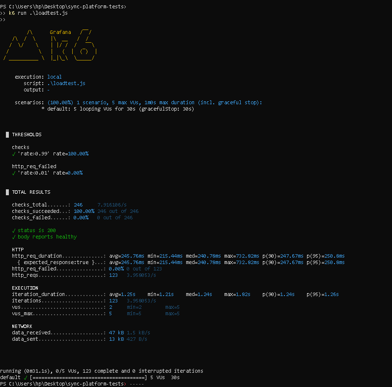
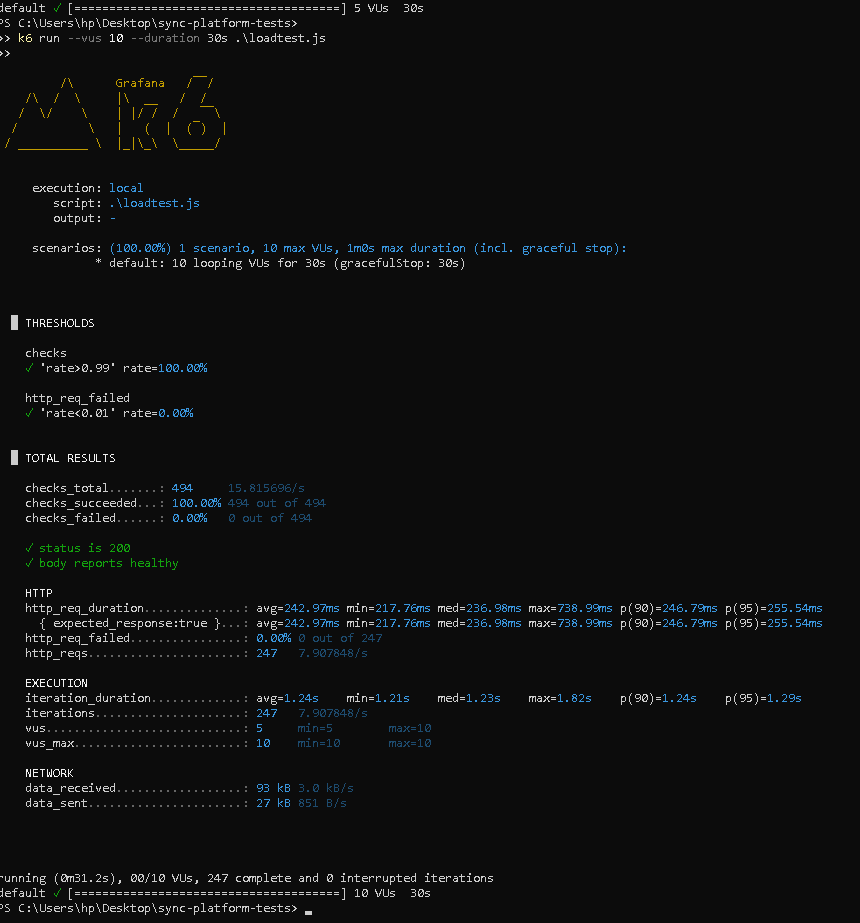
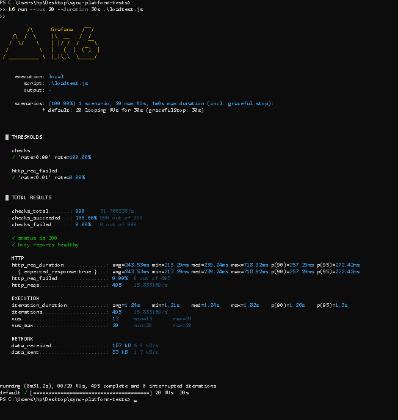
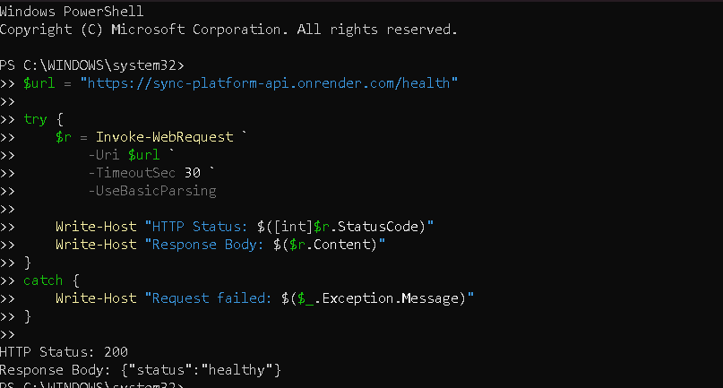

# Deployed performance results

The following are controlled baseline k6 test results for the deployed API. These are *controlled baseline tests, not maximum-capacity benchmarks*, because the test scripts wait approximately one second between requests.

### Health endpoint load tests

| 5 virtual users | 10 virtual users | 20 virtual users |
|---|---|---|
|  |  |  |

### Database-backed status test

---

## Verified k6 metrics (baseline)

- **Health (5 VUs):** duration=30s, requests=123, failures=0, avg=245.76 ms, p95=250.8 ms, successful checks=246/246
- **Health (10 VUs):** duration=30s, requests=247, failures=0, avg=242.97 ms, p95=255.54 ms, successful checks=494/494
- **Health (20 VUs):** duration=30s, requests=495, failures=0, avg=243.53 ms, p95=272.42 ms, successful checks=990/990
- **Database-backed status (5 VUs):** duration=30s, requests=120, failures=0, avg=262.04 ms, p95=294.52 ms, successful checks=240/240

Notes:
- These runs were executed as controlled baseline tests. The k6 scripts used between-request think/sleep times (approximately 1 second), so these are not indicative of maximum throughput for the service under sustained high-concurrency conditions.
- The listed request counts and successful-check totals reflect the k6 output for each run.

Files referenced (relative to this file):
- docs/results/deployed-api/health-load-5vus.png.png
- docs/results/deployed-api/health-load-10vus.png.png
- docs/results/deployed-api/health-load-20vus.png.png
- docs/results/deployed-api/status-load-5vus.png.png

If you'd like, I can also:
- Add the raw k6 JSON output files to the same directory (if you provide them),
- Add a short summary table summarizing average throughput (requests/sec) and error percentages,
- Create a comparison chart combining these runs.
